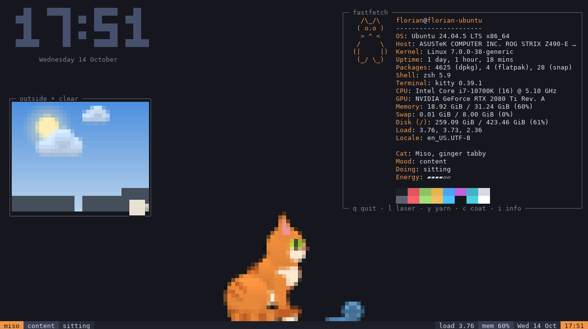
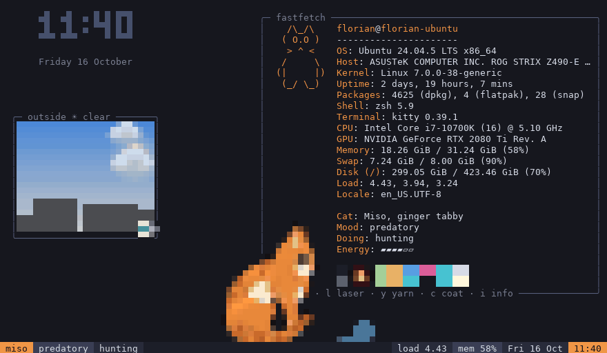
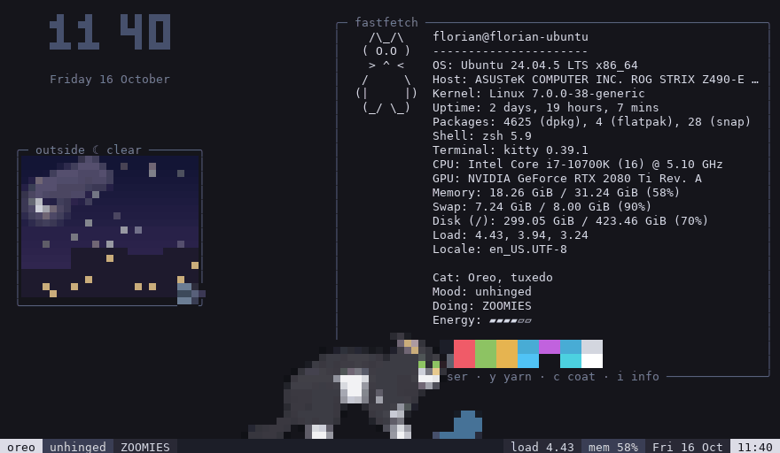
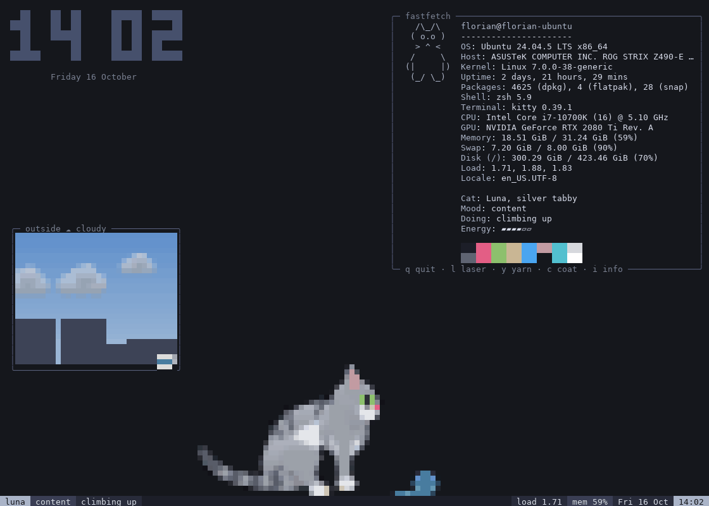
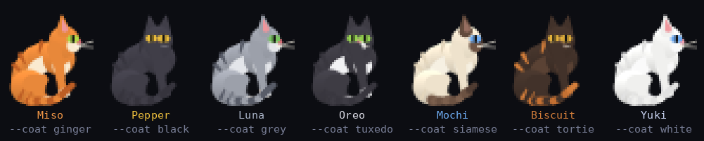
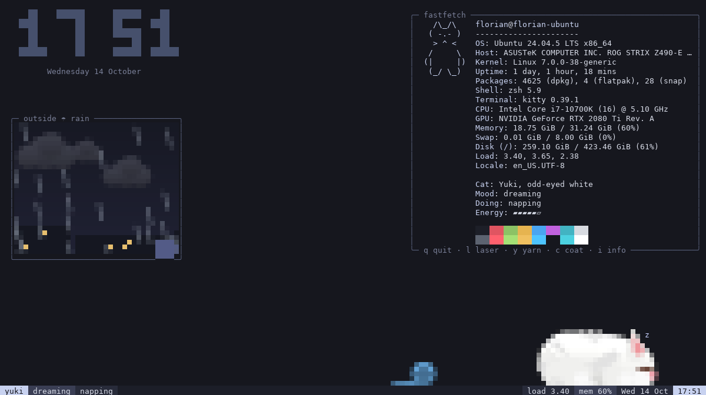
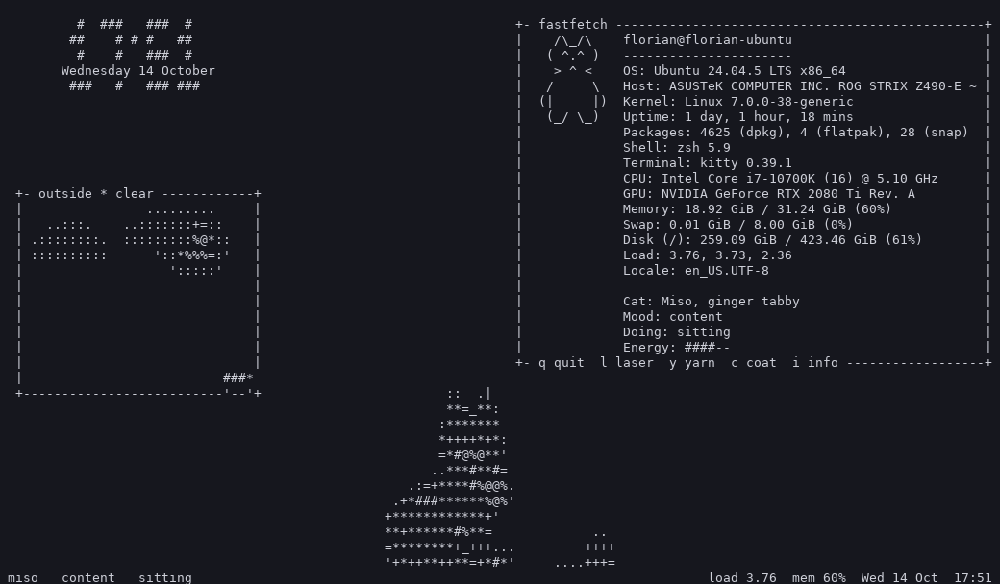
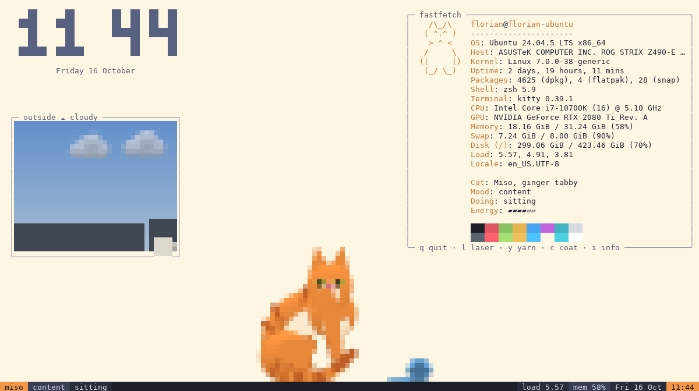

# kittyfetch

A cat that lives in your idle terminal. Leave it running on a spare monitor:
it naps, grooms, watches birds, stalks the laser dot, gets the zoomies at night
and knocks the mug off the ledge while looking you in the eye. Next to it sit a
tty-clock and a fastfetch pane with your real system info.

One Python file, standard library only.



| Laser hunt (press `l`, or move the mouse) | Night zoomies, with a wall kick |
|---|---|
|  |  |

| Wall-kicking up onto the fastfetch box |
|---|
|  |

## Run it

```bash
python3 kittyfetch.py
```

Needs Python 3.8+ on Linux or macOS and a truecolor terminal (kitty, WezTerm,
Alacritty, GNOME Terminal, iTerm2, Windows Terminal via WSL, ...). There is
nothing to install. Ctrl-C or `q` quits and restores the terminal.

```bash
python3 kittyfetch.py --coat siamese     # pick a cat
python3 kittyfetch.py --ascii            # plain ASCII, no colour
python3 kittyfetch.py --timelapse 120    # watch a day go by in 12 minutes
```

### Keys

| Key | |
|---|---|
| `q` / Ctrl-C | quit |
| `l` | start / stop a laser pointer session |
| mouse | a laser dot follows the pointer |
| `y` | toss the yarn into the room |
| `c` | next cat |
| `i` | show / hide the fastfetch pane |
| `a` | toggle ASCII mode |

### Options

| Option | |
|---|---|
| `--coat NAME` | `ginger`, `black`, `grey`, `tuxedo`, `siamese`, `tortie`, `white` (default: random) |
| `--ascii` | plain ASCII rendering |
| `--bg '#rrggbb'` | your terminal's background colour, if it doesn't report it (most do) |
| `--no-mouse` | don't capture the mouse (keeps text selection working) |
| `--fps N` | frame rate while the cat is awake (default 20; it drops to 10 while asleep) |
| `--hour H` | pretend it is this hour, for the sky outside |
| `--timelapse X` | run the day/night cycle X times faster |
| `--seed N` | reproducible runs |

## The cats



Each run picks one at random. Their name, mood and current activity show in
the status bar and the fastfetch pane, whose accent colour follows the coat.

## What it does

- **Moods that drift.** Energy, boredom and mischief rise and fall over time and
  decide what happens next, with a penalty on repeating recent activities so
  you don't see the same thing twice in a minute.
- **Behaviours that chain:** waking up (blink, yawn, stretch, groom),
  napping (kneads, turns round once, curls up, breathes, dreams with twitching
  paws), wandering and sniffing, loafing, slow-blinking at you, grooming paws,
  face and flank, surveying the room from on top of the fastfetch box, bird watching from the ledge (chattering, pawing at the
  glass), batting and stalking the yarn, laser hunting (stalk with frozen mid-step
  paws, butt wiggle, pounce, peeking under the paw), zoomies with wall skids and
  wall kicks (paws on the wall, push off, twist), being startled, and knocking the mug off the ledge.
- **Cat logic.** It never walks backwards: it turns, leading with the head,
  the spine bending as the hips follow. It pauses mid-walk, gets bored of the
  laser and gives up, and grooms after the zoomies as if nothing happened.
- **A small world.** The status bar is the floor, and the bottom borders of the
  "outside" pane and of the fastfetch box are ledges to jump on. The sky follows your clock (sun, moon,
  stars, lit windows across the street) and the weather changes. Birds land on
  the ledge outside. The mug gets tidied back onto the ledge while the cat sleeps.
- **fastfetch pane:** OS, host, kernel, uptime, packages (dpkg, pacman, flatpak,
  snap), shell, terminal, CPU, GPU, memory, swap, disk, load, battery and locale,
  read from `/proc`, `/sys` and `/etc/os-release`. Live values refresh every
  two seconds.

| Night | ASCII mode |
|---|---|
|  |  |

| Light terminal theme (detected automatically) |
|---|
|  |

## How it works

**Rendering.** Every terminal cell is two vertical pixels drawn with `▀`/`▄`
and truecolor foreground/background, so the cat is smooth, antialiased pixel
art. At startup it asks the terminal for its background colour (OSC 11), so
edges blend into your theme and text switches to a light-theme palette when
needed. Pixels left at the background colour are emitted as the terminal's
default background, so the scene sits on your own theme. Text panes are drawn
*behind* the cat: a cell shows text only where no pixel is drawn. Each frame
is diffed against the previous one and sent as a single write wrapped in
synchronized-output escapes, so there's no flicker and very little output
while the cat sleeps.

**The rig.** The cat is a procedural 3D skeleton seen from the side, not
sprites. A pose is about 25 numbers (where the hips and shoulders sit, head
offset, tilt and yaw, ears, eyes, tail curl, paw rests, ...), each driven
toward its target by a critically damped spring with its own stiffness, so
ears and tail lag the body and everything eases in and out. From those numbers
the skeleton is rebuilt every frame:

- **Spine:** seven vertebrae with a fixed total length. Poses can only bend the
  back, never stretch it: bring the hips and shoulders together and it domes
  (loaf) or curls (sit), and the gallop's stretch-and-gather cycle bunches and
  extends it.
- **Front legs:** a shoulder blade that pivots on the ribcage and follows the
  leg's swing, then upper arm and forearm (2-bone IK, elbow back).
- **Hind legs:** digitigrade: thigh and shin (knee forward), then a long ankle
  bone that lies flat when the cat sits.
- **Paws** are planted in world space. When the pose drifts away from a planted
  paw (turning, sitting down, shifting weight) it takes a quick arcing step, in
  diagonal pairs, landing a little ahead of where the body is going.
- **Gait:** while moving, paws follow a **gait clock** that advances with
  distance travelled, so they never skate. The walk is a lateral sequence; the
  gallop is a rotary gallop modelled on Muybridge's photographs, with two flight
  phases per stride (stretched out after the hind push, bunched up after the
  fore push) and the spine extending and gathering on those beats.
- **Jumps** have stages: the hind paws stay planted while the body extends off
  them, the forelegs tuck, the body stretches in flight, and the forelegs reach
  down so they land before the hind legs.
- **Tail:** a chain of angle springs, stiffer at the root, so the tip trails.
- **Turning** is choreographed (head, then shoulders, then hips), with the
  spine's heading blended along its length so the body curls round.

**Platforms and walls.** The status bar, the bottom border of the "outside"
pane and the bottom border of the fastfetch box are all floors. A small
planner chains jumps between them (via the floor if needed). When a ledge is
too high for a plain jump, the cat runs at the screen edge, plants its paws on
the wall and kicks off, twisting round in the air to land on it. The zoomies
use the same wall kick.

**Behaviours** are Python generators (`b_nap`, `b_hunt`, `b_zoomies`, ...).
Each `yield` is a frame, so a behaviour reads like a script with pauses in it
and can be interrupted between frames (the laser, a bird landing, a sudden
noise).

## Development

```bash
python3 kittyfetch.py --soak 600 --seeds 6     # headless: 6 seeds x 10 simulated minutes
python3 kittyfetch.py --force zoomies,knock    # run these behaviours first
python3 kittyfetch.py --shots out/ --frames 400 --every 20 --force hunt --laser   # PNGs of the pixel layer
```

The soak test runs random terminal sizes (one in ASCII mode), random laser,
yarn and resize events, and asserts that the state stays finite and in bounds,
that no behaviour runs past its time limit, and counts any visible head
"snaps". It also prints frame-time statistics: typically 1–5 ms per frame, so
the program uses a few percent of one core.

## Known rough edges

- Under about 100 columns the fastfetch pane takes up a lot of the screen (the
  cat walks in front of it). Press `i` to hide it.
- There's no 256-colour fallback: it's truecolor or `--ascii`.
- The wall is the bare screen edge, so there's nothing visible for the paws to touch.

## License

MIT, see [LICENSE](LICENSE).
